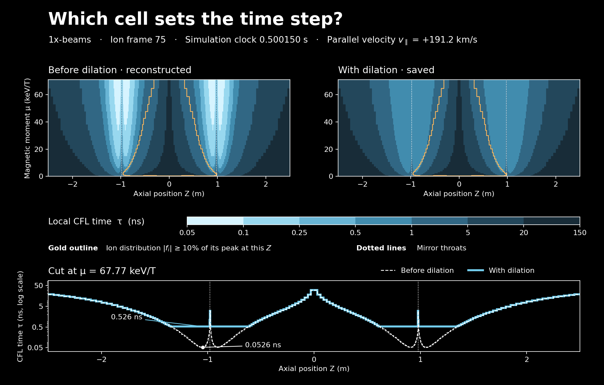

# Which cell sets the time step?

Proposed companion to the clock mobile and the phase-space sculpture. Let visitors follow one cell from the lamps to a contour measured in nanoseconds. The question at the plinth is **“Would you look for the shortest step where most of the ions are?”**

## Text for the gallery

**Beside the mobile · One clock for the whole grid**

> Gkeyll groups ions by where they are and how they move. An ion can travel into a neighbouring box along the mirror. It can also enter the next velocity bin by changing speed while still in the same part of the mirror. At each update, Gkeyll checks the widths of the boxes and how fast either crossing could happen. The shortest allowance sets one time step for the whole grid, even if that box holds hardly any ions.

**Beside the contours · Why look near a mirror throat?**

> The mirror’s narrow, high-field region is called a throat. Just to either side, the field changes sharply with distance. An ion with a large magnetic moment, μ, carries a lot of energy in its circling motion per unit of field strength. On the steep slope it feels a strong push back toward weaker field. Its speed along the field can change by a whole velocity bin in a fraction of a nanosecond. Most ions with that much circling motion turn back before they reach the steep slope.
>
> Choose **Show ion population**. In this snapshot, about 45 of every 100 boxes are slowed. Together they hold about six parts in 100,000 of the ion content, counting each box by magnitude.

**At the controls · What changes when the fastest cells slow down?**

> Choose **Find shortest step**. On the outer slope of the left throat, this box would allow just 0.0526 nanoseconds per step. Switch to **With dilation**. For every tick of the shared clock, Gkeyll advances this box through one tenth of that interval. Now the grid can take a step of 0.526 nanoseconds. Move the probe to the middle of the mirror. What happens there when you switch?
>
> With steps ten times as long, Gkeyll covers the same stretch of simulation time in about one tenth as many updates. That lets us follow the slow changes caused by collisions as the plasma settles. An ion still follows the same path in a given field. The calculation changes how long it takes to travel that path.

## Sculpture and controls

Add a **Local CFL time** view to the phase-space plinth. Keep axial position $Z$ (m), parallel velocity $v_\parallel$ ($10^6$ m/s) and magnetic moment $\mu$ (keV/T) on the same rulers as the ion sculpture. Each contour encloses the mapped cells that permit a local CFL time $\tau$ **at or below** the selected number of nanoseconds. Use the same time levels in both views, starting at 0.1 ns. Offer 0.25, 0.5, 1, 5 and 20 ns as well.

- Start the probe on the cell selected on the mobile. **Find shortest step** moves it to the most restrictive cell. Keep it pinned while switching **Before dilation · reconstructed** and **With dilation · saved**. At 0.1 ns the patches along both throats disappear when the cap is applied. Show the count “0 cells at or below 0.1 ns” so the visitor can read that outcome. **Show time floor** outlines the cells brought to 0.526 ns using the saved $\beta<1$ mask.
- **Show ion population** overlays the existing contour at 10% of the velocity-space peak of $|f_i|$ at each $Z$. Label the key **Local step limit $\tau$ (ns)**. Show the probe’s three coordinates, both time limits, and the dimensionless time factor $\beta$. Keep the run, frame and simulation-clock time beside the key. The mobile’s 3.6-second beat illustrates $\beta$ on an exhibit clock.
- Put the controls on the aisle-facing edge within seated reach. Use white lettering on matte black with numbered time swatches. Support click or right trigger and the lectern’s Tab, Shift+Tab and Enter controls.

The sketch cuts through the cell with the shortest reconstructed time. Both maps use the same native cell faces and time bands. The gold line follows the 10% distribution boundary. The lower profile follows the highest magnetic-moment bin and uses a logarithmic time axis.

## How Gkeyll sets the step

The Courant–Friedrichs–Lewy (CFL) condition limits an explicit update. In the thesis's ion calculation the streaming and acceleration contributions to the local rate scale with $|v_\parallel|/\Delta\ell$ and $|\dot v_\parallel|/\Delta v_\parallel$, with weights set by the numerical basis. The mirror force along a field line is $-\mu\,\partial B/\partial\ell$. Large $\mu$, a steep gradient and narrow velocity bins near zero can make the second contribution large. Gkeyll takes the maximum rate across cells. The ion CFL bound on the common Runge–Kutta step is $C_{\rm CFL}/\max\omega$, where $C_{\rm CFL}$ is the Courant factor. Other stability limits or the time left to a phase endpoint can shorten an accepted step. [Thesis §4.1.4, Eq. 4.23](<../../PhD-thesis-latex/Chapter Gkeyll Foundations/tex-files/gyrokinetic-model.tex>) · [Original high-field mirror calculation](https://doi.org/10.1063/5.0152440)

In the final full-dynamics phase of `1x-beams`, the input caps the rate at one tenth of the largest unscaled rate $\omega_0$ on the grid at each update. Each cell receives $\beta=\min(1,\omega_{\rm cap}/\omega_0)$. The rate alone chooses the mask. Multiplying the complete ion update, including collisions and sources, by a positive $\beta$ preserves its stationary solutions. A factor that varies across cells changes transient timing and can alter particle and energy balance. [Run input](../gkeyll-data/1x-beams/sim.c) · [Thesis §4.6, time dilation](<../../PhD-thesis-latex/Chapter Gkeyll Foundations/tex-files/time-dilation.tex>)

The thesis tested that trade-off with two beam runs. Their median steps during the final full-dynamics phase were 0.0526 ns with dilation off and 0.526 ns with it on. Their endpoint ion inventories differed by 0.00107% and their wall powers by 0.446%. The runs used different solver revisions. [Thesis §5.6.3, measured sensitivity and Figs. 5.23–5.25](<../../PhD-thesis-latex/Chapter Gkeyll POA simulations/tex-files/without-time-dialtion.tex>)

## Source and checks for the contour sketch

**Beam-source ions · frame 75 · simulation clock 0.500150 s.** In `gkeyll-data/1x-beams/`, `zzim-ion_cflrate_75.gkyl` already contains the capped rate $\omega_s=\beta\omega_0$ in s⁻¹. The matching `zzim-ion_fdot_multiplier_75.gkyl` contains $\beta$. Both are cellwise constants. The two views use the same instantaneous state. Their local time allowances in seconds are

$$
\tau_{\rm before}=\frac{\beta}{\omega_s},\qquad
\tau_{\rm with}=\frac{1}{\omega_s}
              =\max\!\left(\tau_{\rm before},\frac{1}{\omega_{\rm cap}}\right).
$$

Multiply by $10^9$ to label contours in ns. This reciprocal is the step a cell permits at unit Courant factor. During one accepted global step $\Delta t$, the cell's update covers the interval $\beta\Delta t$. In the solver revision recorded in the file (`3e32cda94b0d`), `gk_species_kinetic.c` scales the rate before taking its maximum and `gk_species.c` writes that scaled array.

Independent Postgkyl cell reads give these reference points at $v_\parallel=+191.195$ km/s and $\mu=67.7667$ keV/T (velocity cells 34 and 31, zero-based). At this frame the rate cap is $1.902714794\times10^9$ s⁻¹.

| Probe | Axial cell | $Z$ (m) | $\beta$ | Before (ns) | With dilation (ns) |
| --- | ---: | ---: | ---: | ---: | ---: |
| Near midplane | 200 | +0.014865 | 1 | 30.1912 | 30.1912 |
| Left throat, field crest | 101 | −0.979129 | 1 | 2.95728 | 2.95728 |
| Left throat, outer slope | 76 | −1.047503 | 0.1 | 0.0525565 | 0.525565 |

Run `python3 gallery-3/tools/plot_cfl_times.py` from the repository root to reproduce the sketch. The script checks the clamp over all 819,200 cells. It uses the run’s axial and velocity maps and the frame-75 ion distribution with the same Jacobians and density check as the mobile. For the plinth, check the exported contour faces and probe readouts against the same mapped cells. [Sketch source and time bands](tools/plot_cfl_times.py) · [Mapping, Jacobians and ion density check](tools/ion_frame.py)

The six parts in 100,000 on the board come from summing the absolute cell-integrated ion counts. The 366,226 slowed cells carry 0.00555% of the total. Within one axial slice the share can be larger, reaching 5.86% just inside the left throat. [Distribution and occupancy manifest](../simulation-renders/gallery-3/time-dilation.json)
