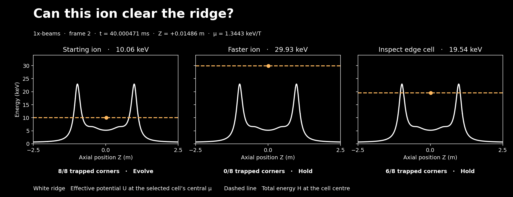
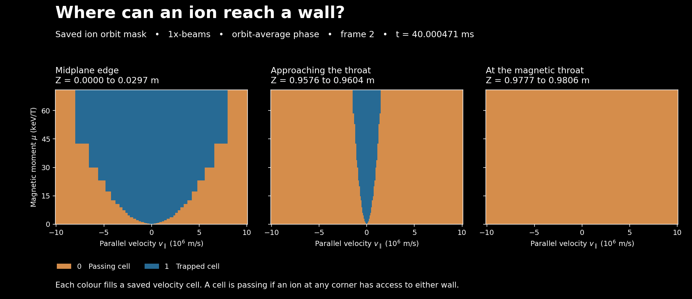
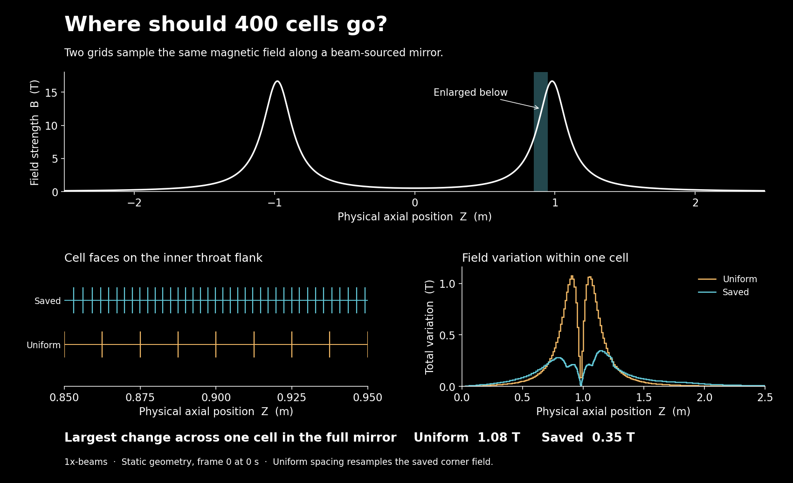

# Gallery 4 · Which ions can reach a wall?

Enter the second doorway on the right and turn left. The energy rail opens on an ion that turns back from both walls. The adjoining colour map shows that Gkeyll classifies the cell containing this ion as passing. Find the blue corner among the seven amber diamonds, then select **Wall corner**. The horizontal energy line moves, and the trace reaches a wall. Both observations come from the same cell in the same saved timestep.

Gallery 1 lets a visitor change the mirror. Here the mirror is the one Gkeyll simulated. The visitor learns to make the solver’s decision, finds it in a saved mask, then investigates how much spatial detail it takes to resolve a turn.

## The energy rail

The opening **Cut cell** trial enlarges the right-hand crest beside the whole-mirror profile. The detailed view shows 61–63 keV at the selected corner. Its dashed energy line crosses the rising ridge just before the crest. Choose **Wall corner** and watch the line clear the same end of the mirror. Both plots draw the same native traces on labelled linear rulers.

The two instruments share the left wall. A shallow relief follows the effective potential along the full five-metre mirror. White triangles mark the highest barrier on each path. The amber segment shows the connected part of the energy line that the ion can reach. **Trace left** or **Trace right** reveals the path from the white cross to a turn or a wall in 2.5 exhibit seconds. **Pause trace** and **Step** let you inspect it. The labelled vertical ruler fits the barriers and the selected energy. **Starting ion** and **Faster ion** share a 0–35 keV ruler so their height difference can be read directly.

The side label asks **“Where does the parallel motion go?”** At fixed magnetic moment $\mu$, the ridge is the effective potential $U(Z,\mu)=\mu B(Z)+q_i\phi(Z)$ (the Yushmanov potential). The height of the line is the Hamiltonian $H=\tfrac12 m_i v_\parallel^2+U$. The gap between the line and the ridge gives the parallel kinetic energy. At the turn the gap closes and $v_\parallel=0$. Select **Show μB, qᵢφ** to reveal the magnetic and electric contributions. A peak of the combined energy can occur away from the magnetic throat.

For frozen fields and collisionless guiding-centre motion, $H$ and $\mu$ are conserved. For each wall take the highest $U$ encountered along the entire path, including the effective sheath endpoint where applicable. At a sheath, compare the plasma-side energy with $\mu B_{\rm wall}+q_i\phi_{\rm wall}^{\rm bc}$ and retain the larger. Label the left and right barriers $E_L$ and $E_R$. The test for a wall-accessible point is $H\geq\min(E_L,E_R)$, with equality assigned to the passing side. Below both barriers the ion is trapped. The sign of $v_\parallel$ gives the initial direction of travel. An ion can turn once and still reach the other wall. This construction answers a reachability question at one instant. Measuring the rate of loss would require flux at the walls.



**Compare two speeds.** Select **Starting ion** to move to the first axial cell to the right of the midplane. Its centre is at $Z=+0.01486$ m, with $B=0.5313$ T and $\phi=4496$ V. At $\mu=1.3443$ keV/T the barrier to either wall is 22.92 keV. Predict whether the energy line will clear the barrier, then select **Faster ion**. Only the parallel speed changes. The third row can be selected directly on the plot. [Energy figure and corner-count checks](tools/energy_rail.py)

| Selection | Centre $v_\parallel$ (10⁶ m/s) | Centre $H$ (keV) | Trapped corners | Saved cell flag |
| --- | ---: | ---: | ---: | --- |
| Starting ion | +0.679 | 10.06 | 8 of 8 | 1 · Evolve |
| Faster ion | +1.533 | 29.93 | 0 of 8 | 0 · Hold |
| Picked midplane cell (45, 8) | +1.168 | 19.54 | 6 of 8 | 0 · Hold |

## Read the saved loss-cone mask

The adjacent board plots signed parallel velocity $v_\parallel$ (10⁶ m/s) against magnetic moment $\mu$ (keV/T). Each rectangle occupies its mapped physical interval. The outlined cell has its own saved flag. A white cross marks the point whose energy appears on the neighbouring rail.



The orbit-average phase (OAP) advances a cell only when **all eight corners** in $(Z,v_\parallel,\mu)$ are trapped. A saved **1** means the cell evolves during this phase. A **0** means at least one corner has a path to a wall and the cell is held. This intentionally holds some trapped phase space at the boundary.

**Cut cell** selects the inner-slope cell $(291,37,11)$. The two enlarged rectangles show its lower and upper axial faces. Compare the single saved cell colour with the pointwise orbit classification inside each face. The blue patch occupies about 17% of the lower face. Only one corner is trapped. Its energy is 62.58 keV, just below the 62.90 keV barrier. **Next corner** visits each corner. **Wall corner** picks one that can pass and lights its route. That blue patch shows which trapped states the solver holds along with their passing neighbours. A face area measures geometry, while the number of ions in a region also depends on its distribution.

Click or use the right trigger anywhere on the coloured velocity map. The cross snaps to the centre of the native cell, updates both axial-face diagrams and sets the energy line and ridge on the left. The fields, location of the axial cut and saved time stay fixed. On desktop, Tab to the plot and use the arrow keys for single-cell steps. **Tip zoom** and **Full mask** change the physical velocity range shown.

**Beam well** picks a corner of cell $(200,32,0)$ at the midplane, with $\mu$ zero to numerical precision and $v_\parallel=+76.2$ km/s. With almost no magnetic contribution, what can turn this ion? In the beam-driven run, off-centre density peaks near the beams’ turning points produce an electrostatic well. The ion energy is 4.555 keV and the two electric shoulders reach 5.236 keV. Trace either way to see the ion turn at $Z\simeq\pm0.105$ m. All eight corners of this lowest positive-speed, lowest-moment cell are trapped.

Choose **Midplane**, **Inner slope** or **Throat** to follow the same velocity cell along the mirror. The axial interval above the mask changes with the cut. At the throat, the crest that confined ions in the central well is now beside them. Of the 2,048 velocity cells per cut, 1,318 evolve near the midplane, 450 on the slope and zero at the selected throat cell. **Reverse v∥** selects the reflected velocity cell.

Use the saved ion multiplier from **1x-beams, frame 2, t = 0.04000047056236778 s**, inside the first OAP. The run log identifies this phase’s multiplier as “Loss cone”. The 400 × 64 × 32 array contains 208,544 ones and 610,656 zeros. Frame 75 of the same diagnostic instead carries the full-dynamics time-dilation factors used in Gallery 3. Source the flat cell colours directly from frame 2 and the explanatory energy line from its electrostatic potential and static geometry. [Mask figure and numerical checks](tools/loss_mask.py)

## Where do the cells go?

Thesis Fig. 4.2 beside the grid asks how close two turning positions can lie. Follow two energy contours in the magnetic-only teaching model from their midplane speeds to their tips at zero parallel speed. At the turns those energies differ by approximately $\mu\,|dB/d\ell|\,|\Delta\ell|$, where $\ell$ is distance along the field line. On a steep slope, ions with visibly different midplane speeds can turn very close together.

At the second station a fixed relief follows the saved $B(Z)$. Beneath it, 401 movable fins mark the faces of 400 axial cells. Start with **Uniform spacing** and the probe at **Steep flank**. Predict what happens to the cell under the probe, then select **Simulation grid**. Taller fins mark every tenth face. The magnifier shows every face within a fixed 100 mm window, including the edges of the selected cell.



At $Z=0.90$ m, equal spacing gives a 12.5 mm cell. The saved grid resolves the inner flank with a cell about 2.46 mm wide. Over the whole five-metre mirror the largest field variation in a single cell falls from **1.08 T to 0.35 T**. These are two samplings of the static geometry from frame 0. [Grid figure and face-coordinate checks](tools/grid_comparison.py)

Use the same field reconstruction, physical span, 400 cells and field scale in both views. At each endpoint report the local cell width $\Delta Z$ (mm) and the field variation through that cell (T). Sum absolute field increments within a cell that crosses a crest. A signed endpoint difference could hide the rise and fall. Let **Midplane** and **Steep flank** repeat the comparison without fine aiming. The uniform rail is a resampling of the same saved field. The motion between rails is a diagram of grid construction, with no simulation clock attached. Show readouts at the two comparison endpoints.

The thesis grid assigns faces by accumulated absolute change in $B$ along a representative field line. It then limits the slope of the map near field extrema and smooths it. The aim is a more even field change per cell, with finite usable widths near the minima and maxima. The grid stays fixed during this run. Each ion’s turning point depends on its energy and magnetic moment.

## The velocity grid and the loss-cone tip

The next instrument on the left shows the 64 × 32 native velocity cells near the midplane. Find the white ring in the computational grid, then find the same cell on the physical velocity and magnetic-moment axes. The colours, distribution values, cyan mask boundary, axial slice and simulation time are identical. Each representation uses its own coordinate ruler.

Select **Loss-cone tip** to enlarge the same 16 columns and 8 rows in both plots. They take up 6.25% of computational space and 0.098% of the physical plot area. Fine parallel-speed spacing resolves ions near a turn, where $v_\parallel$ approaches zero. Fine magnetic-moment spacing resolves the narrow loss boundary near its tip. Hide the grid or boundary independently to follow the ion distribution. The ring marks cell $(32,0)$ from **Beam well**.

Colour measures the magnitude of the cell-averaged distribution, divided by its peak in this cut and shown on a logarithmic scale. The signed values remain in the export. Integrating the signed reconstruction across velocity reproduces the saved density in all 400 axial cells, including the midplane and throat. [Distribution converter](tools/velocity_grid.py) · [Instrument check](tools/check_velocity_grid.gd)

## Prints and room layout

| Position | Print and reading prompt |
| --- | --- |
| Middle of the right wall, beside the grid rail | **Thesis Fig. 4.2, phase compression.** Follow two energy contours from the midplane to their separate turning positions. The example uses $B(\ell)=\ell^6$ in model units. |
| Far wall, facing the return path | **Thesis Fig. 4.5, baseline mirror field.** Find the same 16.66 T peak on the physical and computational rulers. It appears at about 0.98 m in physical $Z$ and 1.23 m in computational $z$. Mapping spreads the steep region over more computational cells. The published figure uses the Maxwellian baseline geometry. The movable rail uses the saved beam run. |

The centre of the room stays clear from the arch to the end-wall print. The energy rail and velocity grid share the left wall. On the right, **Why is this cell marked passing?** directs visitors to compare two corners of the same cell at the energy rail, followed by the turning-point print and the axial grid. Each thesis caption is centred beneath its graphic. From the hall the visitor sees empty blackboards and cabinets. The room loads the lettering, instruments and both prints on entry, releases them on exit and keeps the selections and animation positions for the return visit.

The frame buttons at either left-wall instrument switch both to frames 2, 40 or 75. Keep a midplane cell selected and compare its distribution and available wall paths. The physical rulers and colour reference stay fixed. Frames 2 and 40 contain binary orbit-average masks. Frame 75 contains full-dynamics multipliers, so its displayed boundary comes from the eight-corner Hamiltonian test on that frame’s frozen fields.

## Reproduce the installation

The exporter reconstructs the two-wall test independently of the saved flags and checks all 819,200 native cells. An independent reference covers all 49,152 corner outcomes on the three clickable cuts. For the enlarged cell faces the instrument calculates the critical parallel speed at 25 evenly spaced magnetic moments and joins the samples. Each corner marker uses its own full path test. The exporter also checks the axial maps, field variation and original print aspect ratios. [Asset manifest](../simulation-renders/gallery-4/manifest.json) · [Exporter](tools/export_exhibit.py)

```sh
python3 gallery-4/tools/export_exhibit.py
python3 gallery-4/tools/entrance_print.py
python3 gallery-4/tools/velocity_grid.py
godot --headless --path . --xr-mode off --script res://gallery-4/tools/check_loss_probe.gd
godot --headless --path . --xr-mode off --script res://gallery-4/tools/check_velocity_grid.gd
godot --headless --path . --xr-mode off --script res://gallery-4/tools/check_visit.gd
godot --headless --path . --xr-mode off --script res://tools/check_quest_controls.gd
```

The desktop room check covers the atrium threshold, a cancelled load, seated and standing pointer rays, direct mask picking, keyboard steps, the two featured cells, the velocity-grid overlay, and pause, exit and re-entry during grid motion. With a display, append `-- --pictures` to the room check and omit `--headless` to capture fixed views in `exports/`. The simulated controller test teleports through the arch and uses the right trigger at all three stations. An uncoached visitor trial and sustained 72 fps measurements on Quest 3 still require a headset session.

Regenerate the planning prints from the repository root with Postgkyl, NumPy, SciPy, Matplotlib and Pillow installed.

```sh
python3 gallery-4/tools/energy_rail.py
python3 gallery-4/tools/loss_mask.py
python3 gallery-4/tools/grid_comparison.py
```

The mask check agrees with the saved flag at every phase-space cell. To reproduce the three speed selections, use zero-based indices $(i_Z,i_{v_\parallel},i_\mu)$ of $(200,40,8)$, $(200,48,8)$ and $(200,45,8)$ in table order. Evaluate the point energy at the centre of each mapped cell and repeat the two-wall test at its eight corners to recover the corner count.

The thesis sources are §§4.3.1–4.3.2 (grid construction) and §§4.4.1–4.4.4 (classification, two-wall test, sheath endpoints and DG cells) in `~/Documents/PhD-thesis-latex`. The original prints are `phase-compression.pdf` and `lorentzian-sims/magnetic-field-coordinates.pdf` under `Chapter Gkeyll POA simulations/figures/`. The linked sketches are offline design studies. The playable museum mounts the room at its second right-hand arch. [Godot scene](game/loss_classification.tscn)
