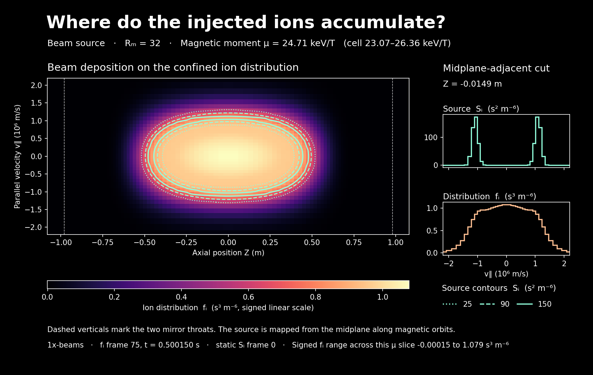

# Gallery 5 · How long does a mirror hold its fuel?

Stand beside the five-metre mirror and turn on **Show injection**. Two narrow bands mark where the beams add ions travelling in opposite directions at the midplane. Pick the band moving toward the right coil. Where along the field line will its parallel velocity fall to zero? Follow the band to its turn, then uncover the final ion population underneath it. Keep the slice, time and rulers fixed and choose **Maxwellian**. The feed now covers a broad range of velocities. At the far wall, use the same two runs to answer a second question. **With almost exactly the same number of ions supplied each second, which mirror holds more fuel?** At the nominal mirror ratio of 32, the beam-fed plasma holds about 11% more ions, corresponding to 90.6 ms of particle confinement versus 81.3 ms.

The playable room opens through the third left-hand arch. Its scientific sources are Maxwell Rosen's thesis, Chapter 5, especially §§5.1–5.4, and M. H. Rosen et al., *Gyrokinetic equilibria of high temperature superconducting magnetic mirrors*. The comparison is between **two ways of supplying deuterium to the same simple mirror**. “Maxwellian” describes the input velocity distribution. Both calculated plasmas can depart from a Maxwellian.

## Visit Gallery 5

At the plinth, **Follow band** traces the measured injection from the midplane to a shoulder and turn at fixed magnetic moment. **Next slice** also reaches the right throat and sheath. Change the source to compare the same cell. Two population thresholds, an injection overlay, and a cut through the sculpture share a probe with the three plots. When the slice has a published counterpart, the frame of Fig. 5.2 identifies its panel. The sculpture holds frame 75 while the other desks replay earlier samples.

The density desk steps both profiles through the five pseudo-orbit-averaging cycles. Zoom the last 90 μs and look for the individual Maxwellian samples. The potential desk has all 76 Maxwellian fields and shares one cursor across the three probes. At the end wall, select a pair of completed runs, switch between milliseconds and scattering times, or open **Fuel & fusion**. The six original thesis figures run down the opposite wall in reading order.

All four stations accept mouse clicks, the right trigger, and Tab / Shift+Tab followed by Enter at the desk. Pausing the museum freezes the clocks. Leaving releases the meshes, prints, and diagnostics. Returning restores the source, slices, probes, frames, and scan selection with playback stopped.

### Data and reproduction

The native beam run is in `gkeyll-data/1x-beams/`. The reduced Maxwellian delivery is in `gkeyll-data/1x-maxw/gallery-5/`. Both describe the audited ratio-32 campaign. Signed velocity integration in each of the 400 axial cells recovers the independent ion and source moments to better than 1.3 × 10⁻¹⁴ relative in both runs. The two whole-tube source integrals reproduce the PRE fueling rates. The independent final potential samples give 7.6215 and 6.0376 in electron-temperature units. [Manifest and per-station verification](../simulation-renders/gallery-5/manifest.json)

Run the exporters from the repository root with Postgkyl, NumPy, SciPy, Matplotlib, Pillow, contourpy, trimesh and Poppler available. The figure exporter takes its original PDF masters from the local thesis checkout. The other tools read the PRE audit and the local simulation outputs.

```sh
python3 gallery-5/tools/phase_export.py
python3 gallery-5/tools/history_export.py
python3 gallery-5/tools/scan_export.py
python3 gallery-5/tools/print_plates.py
```

Use Godot 4.7 to exercise the calculations and the normal museum entrance. Add `-- --pictures` to the visit check with a desktop display for fixed views in `exports/`. The Quest input check teleports from the atrium and operates the scan and potential desk with a simulated right controller.

```sh
godot --headless --xr-mode off --script res://gallery-5/tools/phase_check.gd
godot --headless --xr-mode off --script res://gallery-5/tools/history_check.gd
godot --headless --xr-mode off --script res://gallery-5/tools/check_visit.gd
godot --headless --xr-mode off --script res://tools/check_quest_controls.gd
```

## Exhibit design

## The walk from the atrium

Use the existing 4 m arch and 10 m bay. Try a 30 m deep room with one level aisle at least 3 m wide. Distances below measure inward from the threshold. Keep the end-wall scan visible as a destination. Someone who visits just the sculpture and the scan should be able to connect the two results.

| Distance | Apparatus and sightline | What visitors do |
| --- | --- | --- |
| 0–8 m | Set the distribution plinth lengthwise on the left, with its midplane cut turned toward the arch. Opposite it, hang the six velocity portraits of Fig. 5.2. | Turn the source contours on over the ions. Move one slice marker on the plinth, cut face and field-line ruler together. |
| 8–15 m | Place the density profiles at the back edge of a low timeline desk. Put the phase dial and two source selectors beneath the profiles. | Step through five cycles and compare the buildup between the coils. Look from the endpoint density peaks back to the beam's turning regions. |
| 15–22 m | Set three probe markers along a second mirror ruler. Place the potential traces directly above and the continuation prints on the opposite wall. | Measure two voltage drops with a common throat probe. Look across the aisle to see what still changes after the main calculation ends. |
| 22–30 m | Give the end-wall confinement plot seven large selectable ticks. Face its lectern toward the plot, with a bench and a clear reading position behind it. | Compare the two supplies at one ratio, then change coil strength. Finish by accounting for the extra ions and their relevance to fusion. |

From the controller position the active marker and the quantity it selects should be in one field of view. Use matte black boards, white axes, text and numbers, with distinct shapes or line styles as well as colour for the two sources. Keep original printed figures intact in black frames. Captions should name their native legends, especially where the profile figures use red/black and the scan uses orange squares/purple circles. Follow the museum's seated reading heights, board renderer, lighting and input conventions. [Sightlines](../SETTING.md) · [Controls](../CONTROLS.md)

## 1 · Where do new ions go?



One section through the proposed sculpture, taken from the local beam run. At μ = 24.71 keV/T, follow the mint source contour from the midplane toward the right until it crosses zero parallel velocity. On the two small plots, the injected ions peak near ±1.06 million m/s while the accumulated population on this cut peaks near zero. Rotate this section into the face of the plinth so a seated visitor can make the same comparison.

Build the sculpture on three **phase-space axes**. Its long edge is axial position $Z$ from −2.5 to +2.5 m. Across the plinth is parallel velocity $v_\parallel$ in m/s. Height is magnetic moment μ in keV/T. Put a field-line ruler and two small coil rings along the front edge to orient the visitor. Only that ruler depicts the device in space. Use one side rail for the physical scales and print any velocity cropping, nonlinear axis or exaggeration beside it.

At nominal $R_m=32$ the field on the selected WHAM-like field line rises from about 0.53 T at the midplane to about 17 T at the throats near ±0.98 m. The end plates lie at ±2.5 m. Both runs start with a tenuous Maxwellian ion population. Both use kinetic deuterium, ion–ion and ion–electron Dougherty collisions and a Boltzmann electron response at 940 eV. The Maxwellian supply has a temperature of 19.523 keV. The beam supply has 25 keV injection energy, 200 eV spread and symmetric 45° injection relative to the two field directions. The integrated feed rates differ by less than 0.01%.

- **Ions.** Draw an opaque, cuttable positive isosurface of the signed final distribution $f_i$ (s³ m⁻⁶), frame 75, 0.500150 s. Use shared physical thresholds for both runs. A cut face shows signed native velocity-cell means and has its own scale. Give the dilute right throat and sheath a labelled log-magnitude view with explicit negative-cell markings. Preserve the same limits between cases in each view.
- **Injection.** Draw a sparse wire surface or outlines of the *saved* static source $S_i$ (s² m⁻⁶) on the same coordinates. Give it an independent legend with absolute levels, and let either layer be hidden. Provide a fixed-μ section through the beam band. The two ridges of injected parallel speed approach zero near the turning points. A cursor there reports both the addition rate and the population in that cell. [Beam-source planning cut and reproducer](tools/plot_source_slice.py)
- **Follow the band.** Pin μ and highlight the pair of source branches. The input projects the midplane source along magnetic-energy contours using $v_{\parallel,0}^2=v_\parallel^2+2\mu[B(Z)-B_0]/m_i$. Thus a given midplane speed is represented at smaller parallel speeds as the field rises. Apply the deck's source support between the throats and its numerical floor. The projection neglects the electrostatic potential. The simulation's trapping test includes it through $\mu B+e\phi$. Label any guide drawn from the mapping “source energy contour.” It illustrates the prescription used to avoid adding fuel at just one point of a trapped orbit during POA.
- **Find what survives.** **Midplane**, **Right throat** and **Right sheath** move the slice, highlight its column in Fig. 5.2 and display its actual sampled $Z$. **Beam / Maxwellian** preserves the selected slice, threshold and aspect. The right-throat cut emphasizes outward-moving ions at low μ. The sheath cut shows a much more dilute population streaming outward. At the midplane let visitors pin a row of μ and compare the two velocity traces, one for input and one for accumulated ions.

**Caption decision.** Chapter 5 describes the beam equilibrium as bimodal in parallel velocity. In the signed frame-75 reconstruction at the slice used for Fig. 5.2 (−0.00743 m), the sampled fixed-μ traces peak in the bins nearest zero. At μ/μₜᵢ,₀ ≈ 3.03, for example, $f_i$ is about 1.10 near zero and 0.87 at $v_\parallel/v_{ti,0}\simeq1.72$, in s³ m⁻⁶. Reserve the two-peak label for the injected source until the author identifies an equilibrium cut or projection that supports it. Visitors can inspect both traces themselves. The off-centre **spatial density** maxima are a separate, resolved feature of the beam run.

## 2 · What changes during five cycles?

Start the timeline at the first saved sample, on a common density scale. **Next cycle** advances both density profiles by one completed orbit-averaged phase (OAP) and full dynamics phase (FDP). Export frames 0, 10, 20, 30, 40, 50 and 75 for this comparison. Each line carries its own header time. Mark the input initial condition separately from the first output. Put the throat marks on every profile. Offer a linear density view for the central peaks and a labelled log view to follow the roughly six-decade fall toward the exits.

Ask the visitor to place a marker where the beam density will peak at the endpoint. The beams turn away from the middle, and the accumulated density has two off-centre maxima. In the local frame-75 beam data, the negative-side peak cell is near −0.355 m at about $2.34\times10^{19}$ m⁻³, compared with $2.17\times10^{19}$ m⁻³ near the midplane. The source turning region at a selected μ and the maximum of density integrated over *all* velocities can occupy different positions. At frame 75, let visitors switch the profile probe to signed parallel flow (m/s), parallel or perpendicular ion temperature (keV), or potential (V). Fig. 5.1 shows how the ions accelerate and the two temperatures separate toward the throat. Its left half uses a linear ordinate and its right half a logarithmic one.

Show five long OAP intervals of 0.1 s each, each followed by 15 μs of FDP. Another 75 μs of FDP makes the last continuous FDP 90 μs. A **Magnify final phase** control expands that interval on a second time axis. Use the local beam density frames 45–75 for this close-up, with their actual timestamps. Mark the Maxwellian density samples available in that interval as individual points. The phase key explains which calculation was active at the selected time.

| Phase key | What Gkeyll advances | Why use this interval? |
| --- | --- | --- |
| Orbit-averaged | Trapped-cell advection is slowed with $\alpha=10^{-3}\beta$. Sources and collisions can build the trapped population while passing cells are held fixed. | One midplane-to-throat transit takes about 1.586 μs. The final Maxwellian midplane collision time is about 57.9 ms. The long steps reach collisional relaxation. |
| Full dynamics | Restore parallel dynamics for passing and trapped ions, allowing them to stream and the plasma to readjust. The baseline retains local time dilation and the low-pass filter. | Changes in potential move the trapped/passing boundary. Alternating phases lets the fast dynamics adjust several times. |

Use discrete samples and a visible phase strip. **Step** and **Pause** always land on a saved value. During playback report simulated elapsed time and the compression for the active interval, or label playback “one saved sample per step.” The timeline describes progress toward an equilibrium on the simulation clock. A separate inset can show the estimated direct-run update count divided by the beam run’s actual count, about 7,630. Label the comparator as an estimate. [POA teaching trial](../gallery-2/README.md) · [Local time dilation](../gallery-3/README.md)

## 3 · Where does the potential fall?

Use the **Maxwellian** history for this trial, as in Fig. 5.5. Three symbols on the ruler follow the midplane, positive throat and right sheath entrance. Their traces share one cursor across all 76 recorded fields. Choose the early rise or a late plateau, then switch the measurement bracket from **Centre to throat** to **Throat to sheath** at the same instant. Show $\phi$ in V and $e(\phi_A-\phi_B)/T_e$ with its sign and ordered endpoints. On a collision-time axis use the final Maxwellian midplane total Dougherty rate $\nu_i=\nu_{ii}+\nu_{ie}$. Show seconds as well.

| Final drop in units of electron temperature | Simulation | Theory comparison |
| --- | ---: | --- |
| Midplane → positive throat | 7.62 | 7.05 from the Dougherty electron-confinement estimate with electron and measured ion confinement times set equal. The simulation is 8.08% higher. |
| Positive throat → sheath entrance | 6.0376 | 6.0445 from adiabatic expansion and magnetic flux conservation using the simulated field and flow. The simulation is 0.114% lower. |

Explain the direction of the force at the ruler. A positive central potential retards escaping electrons and accelerates positive ions outward. Matching electron and ion escape is the ambipolar condition. The central estimate uses kinetic electron theory as a benchmark for a calculation with Boltzmann electrons. The expander tests a different relation, $e\Delta\phi/T_e=\ln[B_m u_\parallel(Z)/(B(Z)u_{\parallel,m})]$. Mark the sheath **entrance** as the last sampled region. Show theory brackets only at the final time.

A small second view on the density desk can mark the beam's shallow local potential well between the off-centre density peaks (depth $e\Delta\phi/T_e=0.0747$). Keep its endpoints and scale visible. This gives a visitor coming from Gallery 4 a way to distinguish that local trap from the much larger drop to the throat.

**How steady is the result?** Hang Figs. 5.3 and 5.4 beside each other. Have the visitor predict which changes more when the OAP stops, the inventory or the energy reaching the walls. Point first to the overlapping central profiles, then to the wall-power trace. A further 300 μs of FDP (189 reference transit times, dilation and filtering retained) changes the beam inventory by 0.0229% and increases total ion wall power by 16.0%. The beam endpoint's outward particle loss divided by injection is 0.8720. Call these approximate confined equilibria. This one comparison carries the conclusion of the resolution and sensitivity work. The confined inventory supports more precise conclusions than expander temperatures or wall losses.

## 4 · How many ions does a stronger mirror keep?

Start the far-wall plot at the same $R_m=32$ pair as the plinth. Keep two counters beneath the selected markers showing ions in the entire tube $N_i$ and ions supplied per second $\dot N_{\rm src}$. Both include the geometry weights in the simulation normalization. The tube extends between both end plates. At the endpoint the Maxwellian counters read $3.384\times10^{19}$ and $4.16117\times10^{20}$ s⁻¹. The beam counters read $3.771\times10^{19}$ and $4.16141\times10^{20}$ s⁻¹. Divide inventory by feed to get the paper's ion particle confinement estimate $\tau_p=N_i/\dot N_{\rm src}$. The wall-loss ratio in the previous trial explains why using instantaneous wall flux as the denominator would give a different estimate.

Set the mirror-ratio dial to **3, 5, 10, 15, 22, 32 or 50**. Each stop selects a pair of completed simulations with the same nominal magnetic ratio, fixed midplane field, electron model and final simulation time. The $R_m=50$ cases use 800 axial cells to resolve the narrower throats. Ask the visitor to predict whether doubling the ratio doubles confinement. First reveal the measured points in milliseconds. Then switch to the paper's vertical axis $\tau_p\nu_{ii}^{90,\mathrm{ref}}$, a dimensionless time in units of each run's final *midplane Coulomb ion–ion scattering time*. It uses the local density and flow-subtracted trace temperature $T_i=(T_\parallel+2T_\perp)/3$. Keep this unit separate from the collision clock at the potential station.

| Nominal mirror ratio | Maxwellian τₚ (ms) | Beam τₚ (ms) | Maxwellian $\tau_p\nu_{ii}^{90,\mathrm{ref}}$ | Beam $\tau_p\nu_{ii}^{90,\mathrm{ref}}$ |
| ---: | ---: | ---: | ---: | ---: |
| 3 | 30.3 | 35.0 | 0.089 | 0.090 |
| 5 | 44.2 | 54.3 | 0.186 | 0.236 |
| 10 | 60.3 | 70.9 | 0.346 | 0.434 |
| 15 | 68.4 | 78.6 | 0.448 | 0.550 |
| 22 | 75.4 | 85.1 | 0.548 | 0.664 |
| 32 | 81.3 | 90.6 | 0.652 | 0.782 |
| 50 | 89.1 | 97.9 | 0.796 | 0.937 |

The normalized points rise approximately logarithmically. **Show fit** adds $0.575\log_{10}R_m-0.211$ for Maxwellian and $0.685\log_{10}R_m-0.246$ for beams. Draw them only over the measured range, on the normalized plot. Collision-driven scattering into the loss cone limits the benefit of increasing the mirror ratio. Keep frame 75 and each run ID visible at the counters. The ratio dial controls this scan. Each baseline sculpture is labelled $R_m=32$. A small methods caption should identify the single field line, collision model and Chapter 5 §5.8's cross-species exchange-weighting issue common to all fourteen runs. The fitted coefficients describe this simulated set.

**Why this matters for fusion.** Let the visitor flip the last counter from residence time back to fuel inventory. At a given steady fueling rate a longer particle residence supports a larger inventory. Predicting fusion power also requires knowing where those ions are and how fast they approach one another. For example, D–T power would be $E_{DT}\int n_D n_T\langle\sigma v\rangle_{DT}\,dV$. The Lawson energy balance additionally depends on how long the plasma retains its energy, $\tau_E$, often summarized by $nT\tau_E$. Chapter 5 supplies an ion **particle** confinement estimate and kinetic distributions in pure deuterium on one field line. Leave the visitor with a measured residence time and the ingredients still required for a reactor-power estimate.

## Prints, exports and construction order

Use the thesis PDFs as the print masters. They live under `~/Documents/PhD-thesis-latex/Chapter Gkeyll POA simulations/figures/`. Use the PRE repository at `~/Documents/PRE-gkeyll-poa-paper/` for its plotting definitions, numerical audit and run provenance. Record the file/version when importing a plate. Use a close-reading position and caption for each multi-panel print.

| Thesis figure | Master relative to the figures directory | Job in the room |
| --- | --- | --- |
| 5.2, p. 129 | `equilibrium/distribution-functions.pdf` | Six velocity portraits, corresponding to PRE Fig. 3. Explain linear midplane versus logarithmic end panels, insets and the print's use of absolute values. |
| 5.1, p. 128 | `equilibrium/equilibrium-moments.pdf` | Locate the density peaks and follow acceleration and temperature anisotropy. |
| 5.5, p. 134 | `equilibrium/potential-evolution.pdf` | Original three-trace history and final brackets, PRE Fig. 1. |
| 5.3–5.4, pp. 130–131 | `verification/fdp-continuation.pdf`, `verification/integrated-diagnostics.pdf` | Optional reading stop for the extra FDP. The profile overlay also appears in PRE Fig. 2. |
| 5.6, p. 135 | `confinement/confinement-time.pdf` | End-wall print, PRE Fig. 4. The interactive version identifies measured points and shows the full fitted equations. |

1. **Build the measured scan and mount the prints first.** Import the fourteen rows of `audit/numbers.json`, retaining each row's directory, frame, time, grid, inventory, input rate and reference frequency. Join to `audit/provenance.json` and the paper's `audit_numbers.py` for the diagnostic files and calculation. Recompute both columns of times and both free-intercept fits from the rows. The scan can open for desktop review before the Maxwellian volume arrives.
2. **Prototype the beam plinth locally.** Use Postgkyl with `gkeyll-data/1x-beams/`, the run's geometry, velocity map and Jacobians. Use the conservative signed cell means from the Gallery 5 exporter, then extract a small set of absolute-threshold surfaces, signed cut textures and the source contours. Test the view with an opaque, clipped population and a sparse injection outline before paying for transparent overlap on Quest. [Gallery 5 exporter](tools/phase_export.py) · [Beam planning slice](sketches/beam-source-slice.png)
3. **Add the matched Maxwellian and time stations.** Extract the missing Maxwellian products from the audited run. [Cluster handoff](../needdata.md) Use the same conversions and phase selections for the local beam case. Reuse print masters for the 300 μs continuation. Save gallery tools beside this plan, runtime scenes in `gallery-5/game/` and packaged assets in `simulation-renders/gallery-5/`. Record physical coordinates, signed quantities, transforms, thresholds, saved times, checksums and precision in an asset manifest. Keep each shipped file below 100 MB and keep the raw diagnostics local.
4. **Open the arch after the trials pass.** Use Gallery 3's room-boundary loading pattern. Show the plinth silhouette from the atrium, request detailed assets on entry, discard a stale request on exit. Store the small selection state separately so returning restores the same source, slice, ratio and time with playback stopped. Museum pause freezes all exhibit clocks; resume continues at the selected instant. Reset to title starts a fresh visit. [Boundary and performance checks](../gallery-3/README.md#rendering-cost-in-the-museum)

## Checks at the plinth and on the headset

- **Population and injection.** Re-integrate each signed velocity distribution with the nonuniform velocity measures and run geometry. Compare to saved independent ion density and source-density moments at native midplane and throat cells for both runs, and check the sheath cell separately. Integrate source density over the whole tube to recover the audited rate. Check negative cells before any masking for display. For the *paper's interpolated samples* at −0.00743, +0.97985 and +2.48750 m, density references are $2.030175\times10^{19},9.982845\times10^{15},2.373773\times10^{13}$ m⁻³ (Maxwellian) and $2.172347\times10^{19},8.647556\times10^{15},1.878956\times10^{13}$ m⁻³ (beam). Use the PRE audit’s independent integrals for the 1% velocity-integral check on that sampling. Native cell centres occupy different coordinates and require their own M0 comparison. See `distribution_functions.py` and `audit/distribution_functions.log` in the PRE repository.
- **Shipped geometry.** Reopen the serialized meshes and slice atlas. Intersect each threshold at the selected native slices, compare boundaries to the source grid in physical coordinates, and check signed readouts against those same cells. Reject a reduction that moves a branch by more than one displayed cell, removes its turn or reverses the throat's outward velocity. Verify source floors, cropped ranges and clipped values are keyed on the instrument.
- **Time, potential and confinement.** Check saved clocks and phase boundaries including the final 90 μs zoom. Recover the two signed drops and the published fits to their quoted precision. Toggle units at ratios 3 and 32, where rounding or using the wrong collision rate would materially change the comparison. Confirm the time scrub never assigns a frame-75 sculpture to an earlier instant.
- **Visitor trial.** Ask an uncoached visitor to point to the turning source band, then find the density maximum. Have them show both endpoints of the expander voltage drop, select both ratio-32 scan markers, and use the counters to explain the difference in residence time. Watch whether they can tell where ions are added, where ions accumulate and which measurements bear on fusion.
- **Desktop and Quest 3.** Give every selector mouse-click, right-trigger and Tab/Shift+Tab + Enter access, with arrows or step buttons for probes. Walk and teleport across the threshold, pause mid-trial, leave during a load and return. Read the most dilute cut and smallest figure ticks from seated and standing positions. Record frame time and memory at the arch, broadside to the plinth with both layers visible, and while changing source. Check sustained 72 fps on the headset before opening the room.
